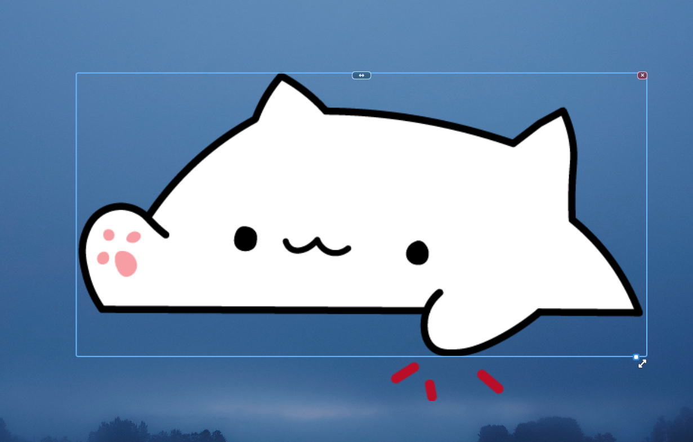

# Bongo Cat Overlay



Простой standalone-оверлей Bongo Cat для Linux/Wayland. Кот реагирует на
нажатия клавиатуры, перетаскивается мышью и не требует Quickshell. Движение
мыши больше не скрывает спрайт.

## Возможности

- Qt 6 Quick + KDE LayerShellQt;
- отображение поверх окон;
- перетаскивание кота левой кнопкой мыши в любое место выбранного монитора;
- изменение размера перетаскиванием за правый нижний маркер после клика по коту;
- кнопка зеркального отражения кота над рамкой;
- кнопка закрытия приложения рядом с кнопкой зеркального отражения;
- реакции на клавиатуру через privacy-minimized evdev helper;
- положение относительно выбранного монитора: `up-left`, `up`, `up-right`,
  `left`, `center`, `right`, `down-left`, `down`, `down-right`;
- размер в процентах от оригинального спрайта;
- запуск из меню приложений через `Bongo Cat`.

## Зависимости

Arch Linux:

```bash
sudo pacman -S --needed base-devel cmake ninja qt6-base qt6-declarative layer-shell-qt
```

Для чтения устройств ввода нужен Python 3 и доступ текущего пользователя к
`/dev/input/event*`.

## Сборка и установка

```bash
git clone https://github.com/MixaDoDs/bongocat-overlay.git
cd bongocat-overlay
cmake -S . -B build -G Ninja
cmake --build build
sudo cmake --install build --prefix /usr/local
```

После установки приложение появится в меню запуска как **Bongo Cat**. Ярлык
устанавливается в `/usr/local/share/applications` и запускает оверлей без терминала. Его
можно запустить из меню или командой:

```bash
bongocat-overlay
```

Для запуска без установки:

```bash
QT_QPA_PLATFORM=wayland ./build/bongocat-overlay
```

## Конфигурация

Создай конфиг:

```bash
mkdir -p ~/.config/bongocat-overlay
cp /usr/local/share/bongocat-overlay/config.ini.example \
   ~/.config/bongocat-overlay/config.ini
```

Файл `~/.config/bongocat-overlay/config.ini`:

```ini
[Overlay]
monitor=DP-1
position=down-right
size=75%
```

`monitor` — имя выхода (`PRIMARY` для основного монитора).

`position` поддерживает девять вариантов начального положения:

```text
up-left   up       up-right
left      center   right
down-left down     down-right
```

Кота можно перетащить левой кнопкой мыши в любое место монитора. После
отпускания мыши приложение сохранит позицию в конфиг:

```ini
[Overlay]
position=custom
x=512
y=240
```

Клик по коту показывает синюю рамку. Рамка облегает видимое тело кота, а не
весь прозрачный спрайт. В правом нижнем углу рамки появляется белый маркер с
диагональной стрелкой — потяни за него, чтобы изменить размер; пропорции
спрайта сохраняются, а левый верхний угол остаётся на месте. Повторный клик по
коту скрывает рамку. Размер тоже сохраняется в конфиг (`size`), поэтому после
перезапуска кот откроется там же и такого же размера. Над рамкой есть кнопка
`↔`: она зеркально отражает кота и сохраняет состояние в `mirror`. Рядом с ней
находится кнопка `×`, которая сразу закрывает приложение.

`x` и `y` — координаты левого верхнего угла оверлея внутри выбранного
монитора. Их можно поправить вручную; при следующем запуске они будут
использованы, пока в `position` указано `custom`. Если указать одно из девяти
именованных положений или передать `--position`, сохранённые координаты
игнорируются.

`size` — масштаб исходного спрайта `600×345` (спрайты обрезаны по видимым
пикселям, поэтому прозрачных полей по краям нет):

```text
100% = 600×345
75%  = 450×259
50%  = 300×173
```

Разрешены значения от `10%` до `200%`. После изменения конфига перезапусти
оверлей. Временные параметры командной строки:

```bash
bongocat-overlay --monitor DP-1 --position center --size 75%
```

## Доступ к вводу и безопасность

Wayland не предоставляет пассивный глобальный доступ к клавиатуре. Standalone
helper запускается от имени текущего пользователя и открывает только доступные
ему `/dev/input/event*`. В приложение передаются только обобщённые события
`L`, `R` и относительное движение мыши; текст клавиш и raw keycode не выводятся.

Если кот не реагирует на клавиши:

1. проверь разрешения текущего пользователя на устройства `/dev/input/event*`;
2. запусти с диагностикой:

   ```bash
   bongocat-overlay --debug-input
   ```

## Разработка

```bash
python3 -m unittest discover -s tests -v
python3 -m py_compile helper/bongo-input
cmake -S . -B build -G Ninja
cmake --build build
```

QML lint:

```bash
/usr/lib/qt6/bin/qmllint -s -I build -I build/BongaCatOverlay Overlay.qml
```

## Лицензии

Код распространяется по MIT License. Четыре исходных кадра Bongo Cat и mapping
клавиш основаны на [wayland-bongocat](https://github.com/saatvik333/wayland-bongocat)
и распространяются по MIT License. Подробности: `LICENSE`,
`LICENSE.wayland-bongocat`, `THIRD_PARTY.md`.
